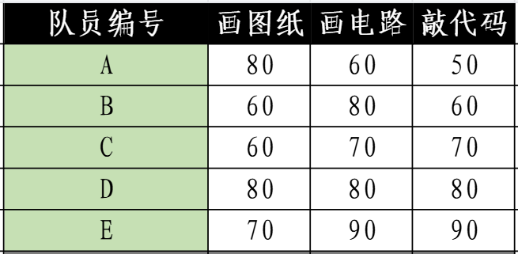
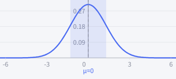
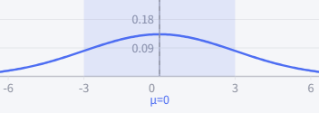

# Kalman滤波器之概率统计基础

## 1 随机向量

约定符号与已有定义

- 随机变量: 大写字母, 如$X$
  - 由于随机变量已经大写了, 因此随机向量将不以小写箭头表示, 而是直接在大写字母上加箭头, 如$\overrightarrow X$
  - 本教程不涉及随机矩阵, 因此无需担心随机矩阵的表示方式
- 期望, expectation: $E(X) = \int_{-\infin}^{\infin} xf(x)dx$
- 方差, variance: $Var(X) = E((X-E(X))^2)$

概率密度函数积分为1
$$
\int_{-\infin}^{\infin}...\int_{-\infin}^{\infin} f(x_1, …, x_n)dx_1...dx_n=1
$$
随机向量$\overrightarrow X$中, $x_m$的边缘概率密度函数
$$
p_m(x_m) = \int_{-\infin}^{\infin}...\int_{-\infin}^{\infin} f(x_1, …, x_n)dx_1...dx_{m-1}dx_{m+1}...dx_n
$$
独立性
$$
f(x_1, …, x_n) = p_1(x_1)...p_n(x_n)
$$
随机变量的协方差, $Cov(X, Y) = Cov(Y, X)$, 且$Var(X) = Cov(X, X)$
$$
Cov(X, Y) = E((X-E(X))(Y-E(Y)))
$$
随机向量$\overrightarrow X$的协方差矩阵, 其表示为
$$
Cov(\overrightarrow X) = E((\overrightarrow X - E(\overrightarrow X)(\overrightarrow X - E(\overrightarrow X))^T)
$$
进一步地, 代入每一个随机变量元素, 有
$$
\begin{pmatrix}

    Var(X_1) & Cov(X_1, X_2) &...& Cov(X_1, X_n) \\

    Cov(X_2, X_1) & Var(X_2) &...& Cov(X_2, X_n) \\
    
    ... \\

    Cov(X_n, X_1) & Cov(X_n, X_2) &...& Var(X_n) \\

\end{pmatrix}
$$
协方差矩阵显然是个对称矩阵

**练习1:**

**队员综合实力考核成绩出来了, 考核科目分别为画图纸 ( 第一个维度 ) , 画电路 ( 第二个维度 ) , 敲代码 ( 第三个维度 ) . 其中, 有五位队员成绩如下, 请根据这些数据, 计算画图纸的方差, 以及画图纸和敲代码之间的协方差, 并给出协方差矩阵**

> 画图纸的期望为
> $$
> \frac{1}{5}(80+60+60+80+70) = 70
> $$
> 画图纸的方差为
> $$
> \frac{1}{5}((80-70)^2 + (60-70)^2 + (60-70)^2 + (80-70)^2 + (70-70)^2) = 80
> $$
> 敲代码的期望为
> $$
> \frac{1}{5}(50+60+70+80+90) = 70
> $$
> 画图纸和敲代码之间的协方差为
> $$
> \frac{1}{5}((80-70)(50-70) + (60-70)(60-70) + (60-70)(70-70) + (80-70)(80-70) + (70-70)(90-70)) = 0
> $$
> 同理, 我们得出
>
> - 画电路的方差为$104$
> - 敲代码的方差为$200$
> - 画图纸与画电路之间的协方差为$-20$
> - 画电路与敲代码之间的协方差为$120$
>
> 因此, 协方差矩阵如下所示
> $$
> \begin{pmatrix}
> 
>     80 & -20 & 0 \\
> 
>     -20 & 104 & 120 \\
> 
>     0 & 120 & 200 \\
> 
> \end{pmatrix}
> $$

从协方差公式不难看出, 协方差是一种带有量纲的度量, 其大小与量纲有关

从上述练习的协方差数值也不难看出, 协方差反映的是两个随机变量之间的相关程度

- 越接近0, 两者的相关性越低
- 绝对值越大, 两者相关性越高
- 协方差为正, 则两者正相关
- 协方差为负, 则两者负相关

## 2 正态分布

期望为$\mu$, 方差为$\sigma^2$的正态分布, 其概率密度函数为
$$
f(x) = \frac{1}{\sigma \sqrt{2\pi}} e^{-\frac{(x-\mu)^2}{2\sigma^2}}
$$

特殊地, 当$\mu=0, \sigma^2=1$时, 为标准正态分布
$$
f(x) = \frac{1}{\sqrt{2\pi}} e^{-\frac{x^2}{2}}
$$
现在, 我们忘记掉正态分布的概率密度函数, 从测量误差的角度开始逐步推导出来正态分布的概率密度函数

### 2.1 正态分布概率密度函数的由来

在物理世界中, 不加特殊干预的前提下, 绝大多数的测量误差都是没有方向的偏好的, 也就是高中化学中常说的 " 各向同性 " , 或者说 " 旋转对称性 " . 放到二维空间 ( 当然三维空间乃至更高维都可以 ) , 我们假设要求的概率密度函数为$f(x, y)$, 其用数学语言描述就是: 

- 期望为0

- 在该二维空间下进行测量, 当然需要有一个坐标系用来刻画和度量. 任取一个坐标轴, 则误差在x和y方向上的两个随机变量应当是相互独立且同分布的
  $$
  f(x, y) = g(x)g(y)
  $$

- 无论如何旋转这个用于测量所取的坐标轴, 其误差的分布都是一致的, 且分布方式只需要一个 " 误差点到原点的距离 " 即可刻画, 也就是将直角坐标系$(x, y)$转换到极坐标系$(r,\theta)$下, 概率密度函数只与$r$有关, 而与$\theta$无关
  $$
  f(x, y) = h(r), r = \sqrt{x^2+y^2}
  $$

有了上述两个公式, 我们可以得出
$$
g(x)g(y) = h(\sqrt{x^2+y^2})
$$
两边同时取对数, 等式仍旧成立
$$
\ln (g(x)) + \ln (g(y)) = \ln (h(\sqrt{x^2+y^2}))

\label{取对数等式}
$$
两边同时对$x$求偏导
$$
\frac{g'(x)}{g(x)} = \frac{h'(\sqrt{x^2+y^2})}{h(\sqrt{x^2+y^2})} \cdot \frac{1}{2}(x^2+y^2)^{-\frac{1}{2}} \cdot 2x
$$
整理, 得到
$$
\frac{g'(x)}{xg(x)} = \frac{h'(\sqrt{x^2+y^2})}{h(\sqrt{x^2+y^2})} \frac{1}{\sqrt{x^2+y^2}}
$$
同理, 对等式$\eqref{取对数等式}$两边同时对$y$求偏导
$$
\frac{g'(y)}{yg(y)} = \frac{h'(\sqrt{x^2+y^2})}{h(\sqrt{x^2+y^2})} \frac{1}{\sqrt{x^2+y^2}}
$$
这说明
$$
\frac{g'(x)}{xg(x)} = \frac{g'(y)}{yg(y)} = \frac{h'(r)}{rh(r)}
$$
由于这个等式需要对任意的$x, y, r$都成立, 因此等式结果必须为常数$a$, 也就是
$$
\frac{g'(x)}{xg(x)} = a \\
\frac{g'(y)}{yg(y)} = a \\
\frac{h'(x)}{rh(r)} = a
$$
这三个是同一个常微分方程, 与此同时也揭露了正态分布的一大性质: 离期望 ( 原点 ) 越远的点, 出现的概率越小, 且**在该点附近的对数密度**与**该点到期望的距离**成正比

下面以第一个为例进行求解

首先, 将常微分方程换一种表达形式
$$
\frac{g'(x)}{g(x)} = a x
$$
而后, 对等式两边同时积分, 求解微分方程
$$
\ln (g(x)) = \frac{a}{2}x^2 + b
$$
其中, $b$也是常数

最终得到概率密度函数的形式
$$
g(x) = e^{\frac{a}{2}x^2 + b}
$$
考虑到$g(x)$是关于随机变量$X$的边缘概率密度函数, 需要可积分, 且积分值为$1$, 因此有$a < 0$

接下来, 问题变为了求解
$$
\int_{-\infin}^{\infin} e^{\frac{a}{2}x^2 + b} dx

\label{所求积分}
$$
或者说
$$
e^b\int_{-\infin}^{\infin} e^{\frac{a}{2}x^2} dx
$$
乍一看无从下手, 不如我们再回到二维平面看一看, 也就是求解
$$
e^b\int_{-\infin}^{\infin} e^{\frac{a}{2}x^2} dx \cdot e^b\int_{-\infin}^{\infin} e^{\frac{a}{2}y^2} dy
$$
求解出结果之后, 给结果开个根号, 就是所求积分$\eqref{所求积分}$的结果

首先, 两个积分相乘的结果, 可以用二重积分表示, 也就是
$$
e^{2b}\int_{-\infin}^{\infin} \int_{-\infin}^{\infin} e^{\frac{a}{2}x^2}e^{\frac{a}{2}y^2} dx dy
$$
整理, 有
$$
e^{2b}\int_{-\infin}^{\infin} \int_{-\infin}^{\infin} e^{\frac{a}{2}(x^2+y^2)} dx dy

\label{整理后的积分}
$$
数学分析下册学过二重积分的换元公式, 我们可以借助下述公式的换元将积分转移到极坐标下
$$
\begin{cases}
    x = r \cos \theta \\
    y = r \sin \theta \\
\end{cases}
$$
对应的Jacobi矩阵为
$$
\begin{pmatrix}
    \cos \theta & -r\sin\theta \\
    \sin \theta & r\cos\theta \\
\end{pmatrix}
$$
显然, 该矩阵行列式为$r$

代入到积分式$\eqref{整理后的积分}$, 有
$$
e^{2b}\int_{0}^{2\pi} \int_{0}^{\infin} e^{\frac{a}{2}r^2} rdr d\theta
$$
先对$\theta$积分, 有
$$
2\pi e^{2b} \int_{0}^{\infin} e^{\frac{a}{2}r^2} rdr
$$
整理, 有
$$
\pi e^{2b} \int_{0}^{\infin} e^{\frac{a}{2}r^2} dr^2
$$
换元, 有
$$
\pi e^{2b} \int_{0}^{\infin} e^{\frac{a}{2}t} dt
$$
世界清静了, 积分得到的结果为
$$
\frac{2\pi e^{2b}}{-a}
$$
将上式结果开根号, 即为所求积分$\eqref{所求积分}$的结果, 这里负号和$a$绑定, 是在时刻提醒$a$是一个负数
$$
e^{b}\sqrt{\frac{2\pi }{-a}}

\label{所求积分结果}
$$
令该值为$1$, 则得到形式的约束, 也就是$e^{b} = \sqrt{\frac{-a}{2\pi}}$

代回$g(x)$, 化简整理, 有
$$
g(x) = \sqrt{\frac{-a}{2\pi}} e^{\frac{a}{2}x^2}
$$
直到现在, 这个正态分布的概率密度函数已经初具人形

但可能还有同学有疑问: 为什么还有个$a$没有消掉?

其实, 我们只约定了期望为$0$, 也就是意味着方差是不确定的! 因此有个$a$没消掉才是合理的

下面关于性质讨论的分析, 我们将围绕期望方差展开

### 2.2 随机变量正态分布的性质

#### 2.2.1 期望

由于求解$g(x)$的过程中, 我们指定的期望为$0$, 即误差是围绕着坐标原点产生的, 因此$g(x)$的期望为0

如若从定义开始推导也是极其容易的
$$
\int_{-\infin}^{\infin} xg(x)dx = \int_{-\infin}^{\infin} x\sqrt{\frac{-a}{2\pi}} e^{\frac{a}{2}x^2}dx
$$
显然, 被积函数是奇函数, 因此其积分为$0$, 得到期望

#### 2.2.2 方差

由于期望为$0$, 即$E(X) = 0$, 代入方差定义
$$
E((X-E(X))^2) = E(X^2) = \int_{-\infin}^{\infin} x^2g(x)dx = \int_{-\infin}^{\infin} x^2\sqrt{\frac{-a}{2\pi}} e^{\frac{a}{2}x^2}dx
$$
整理, 有
$$
\sqrt{\frac{-a}{2\pi}} \int_{-\infin}^{\infin} x^2 e^{\frac{a}{2}x^2}dx
$$
继续整理, 有
$$
\frac{1}{a} \sqrt{\frac{-a}{2\pi}} \int_{-\infin}^{\infin} x de^{\frac{a}{2}x^2}
$$
分部积分法, 有
$$
\frac{1}{a} \sqrt{\frac{-a}{2\pi}} (x e^{\frac{a}{2}x^2}\Big|_{-\infin}^{\infin} - \int_{-\infin}^{\infin}e^{\frac{a}{2}x^2}dx)
$$
化简, 也就是
$$
\frac{1}{-a} \sqrt{\frac{-a}{2\pi}} (\int_{-\infin}^{\infin}e^{\frac{a}{2}x^2}dx)

\label{方差的公式}
$$
由于我们之前已经在上一小节求解过积分$\eqref{所求积分}$, 其结果在公式$\eqref{所求积分结果}$中, 为$e^{b}\sqrt{\frac{2\pi }{-a}}$

因此, $\int_{-\infin}^{\infin}e^{\frac{a}{2}x^2}dx$的结果显然为$\sqrt{\frac{2\pi }{-a}}$

代入到方差的公式$\eqref{方差的公式}$, 也就是
$$
\frac{1}{-a} \sqrt{\frac{-a}{2\pi}} \sqrt{\frac{2\pi }{-a}} = \frac{1}{-a}
$$
我们假设方差为$\sigma^2$, 也就是$\frac{1}{-a} = \sigma^2$

我们得到
$$
a = -\frac{1}{\sigma^2}
$$
再将$a$值代回$g(x)$, 有
$$
g(x) = \frac{1}{\sigma\sqrt{2\pi}} e^{-\frac{1}{2\sigma^2}x^2}
$$

#### 2.2.3 更一般化的期望

而后, 我们在想, 当期望为更一般的情况, 也就是非$0$值$\mu$时, 概率密度函数的样子是什么?

将分布函数的$x$替换为$x-\mu$, 也就是沿着$x$轴平移$\mu$个单位长度, 得到的就是更一般的情况, 此时的概率密度函数为
$$
\frac{1}{\sigma\sqrt{2\pi}} e^{-\frac{1}{2\sigma^2}(x-\mu)^2}
$$
这就是正态分布的最终形态!

#### 2.2.4 正态分布的性质

经历了上述过程, 我相信根据定义证明后文的所有结论对大家而言都是小意思, 本次课程的后续结论都将不加证明直接给出

对于两个相互独立的正态分布$X\sim (\mu_x, \sigma_x^2), Y\sim (\mu_y, \sigma_y^2)$

- $E(X) = \mu_x$
- $Var(X) = \sigma_x^2$
- 其线性变换$aX+b$同样也是正态分布, 且$(aX+b)\sim (a\mu_x+b, a^2\sigma_x^2)$
- 其线性组合$aX+bY$同样也是正态分布, 且$(aX+bY)\sim (a\mu_x+b\mu_y, a^2\sigma_x^2 + b^2\sigma_y^2)$

### 2.3 随机向量的正态分布

当随机变量扩展到随机向量的时候, 我们就要考虑随机向量中每个随机变量间的相互作用了

因此, 随机向量的正态分布需要额外引入协方差矩阵$\Sigma$

这里, 我们形式化地给出$n$维随机向量$\overrightarrow X\sim(\overrightarrow{\mu}, \Sigma)$的概率密度函数, 并直接给出其性质
$$
g(\overrightarrow x) = \frac{1}{\sqrt{|\Sigma|}(2\pi)^{\frac{n}{2}}} e^{-\frac{1}{2}(\overrightarrow{x}-\overrightarrow \mu)^T \Sigma^{-1} (\overrightarrow{x}-\overrightarrow \mu)}
$$

对于两个相互独立的正态分布$\overrightarrow X\sim(\overrightarrow{\mu_x}, \Sigma_x), \overrightarrow Y\sim(\overrightarrow{\mu_y}, \Sigma_y)$

- 其线性变换$A\overrightarrow{X}+\overrightarrow{b}$同样也是正态分布, 且$(A\overrightarrow{X}+\overrightarrow{b})\sim (A\overrightarrow \mu_x+\overrightarrow b, A\Sigma_x A^T)$
- 其线性组合$A\overrightarrow X+B\overrightarrow Y$同样也是正态分布, 且$(A\overrightarrow X +B\overrightarrow Y)\sim (A\overrightarrow \mu_x, + B\overrightarrow \mu_y, A\Sigma_x A^T + B\Sigma_y B^T)$

## 3 随机变量数据融合思想

**系统建模:**

- **我们有两个采集同一个数据的传感器, 采集得到的数据, 其误差分别服从如下两个分布: $X\sim(0, \sigma_x^2), Y\sim(0, \sigma_y^2)$**
- **我们在某一时刻采样到了具体的值$x, y$**

**问题: 如何设计加权平均系数$a$, 从而使得加权平均结果$ax+(1-a)y$的值最接近真实值**

> 如何度量 " 真实值 " 是一个有趣的问题
>
> 对于正态分布而言, 我们能从分布中得到的信息, 一个是均值, 一个是方差
>
> 均值都是0, 没有什么区别. 两个传感器唯一的区别就是方差
>
> 众所周知, 对于这些传感器, 误差的方差越小, 这个传感器采集的数据越集中, 采集得到的数据越可能接近真实值, 所给的权重应当越大
>
> 如下图所示, 显然第一个是比第二个方差要小, 因此需要给较高权重
>
> 
>
> 接下来的问题演变成, 如何设计加权平均系数$a$, 使得加权平均结果$ax+(1-a)y$的方差最小
>
> 我们先要知道随机变量$aX+(1-a)Y$的分布, 显然它也是正态分布, 且根据上一小节的性质公式有
> $$
> aX+(1-a)Y\sim (0, a^2\sigma_x^2+(1-a)^2\sigma_y^2)
> $$
> 方差$a^2\sigma_x^2+(1-a)^2\sigma_y^2$仅有一个变量$a$, 可以看作是关于$a$的函数$f(a) = a^2\sigma_x^2+(1-a)^2\sigma_y^2$
>
> 也就意味着, 我们要求下述函数的极小值
> $$
> f(a) = a^2\sigma_x^2+(1-a)^2\sigma_y^2
> $$
> 首先, 我们先整理这个函数
> $$
> f(a) = (\sigma_x^2 + \sigma_y^2)a^2 -2\sigma_y^2 a + \sigma_y^2
> $$
> 这是一个开口向上的二次函数抛物线, 有最小值
>
> 根据初中数学, 其最小值出现在$a = \frac{\sigma_y^2}{\sigma_x^2 + \sigma_y^2}$处, 其对应的最小值为$\frac{\sigma_x^2\sigma_y^2}{\sigma_x^2 + \sigma_y^2}$
>
> 代入, 得到$ax+(1-a)y = \frac{\sigma_y^2x + \sigma_x^2 y}{\sigma_x^2 + \sigma_y^2}$

这就意味着: 

加权平均系数$a$为
$$
a = \frac{\sigma_y^2}{\sigma_x^2 + \sigma_y^2}
$$
时, 所得到的结果方差最小, 也就意味着数据越可能接近真实值, 数据越好

方差最小值为
$$
\frac{\sigma_x^2\sigma_y^2}{\sigma_x^2 + \sigma_y^2}
$$
加权平均结果为
$$
ax+(1-a)y = \frac{\sigma_y^2x + \sigma_x^2 y}{\sigma_x^2 + \sigma_y^2}
$$
